<div align="center">
  

  <h1>pino-quiet</h1>

  <p>
    <a href="#features">Features</a> •
    <a href="#installation">Installation</a> •
    <a href="#quick-start">Quick start</a> •
    <a href="#pino-pretty-and-other-transports">pino-pretty &amp; other transports</a> •
    <a href="#documentation">Documentation</a>
  </p>

  <p>
    <a href="https://github.com/Silent-Watcher/pino-quiet/blob/master/LICENSE">
      
    </a>
    <a href="https://www.npmjs.com/package/pino-quiet">
      
    </a>
    <a href="https://github.com/Silent-Watcher/pino-quiet/actions">
      
    </a>  </p>
</div>

> `pino-quiet` is a lightweight [Pino](https://getpino.io) transport that **reduces log noise** by collapsing repeated consecutive log messages into a single entry with a repetition counter.

It improves readability, cuts storage/ingestion costs, and requires zero changes to your existing logging calls.

```
{"level":30,"msg":"Connecting..."}     ┐
{"level":30,"msg":"Connecting..."}     ├──▶  {"level":30,"msg":"Connecting... (x3)","repeats":3}
{"level":30,"msg":"Connecting..."}     ┘
{"level":30,"msg":"Connected!"}        ──▶  {"level":30,"msg":"Connected!"}
```

## Features

- **Zero-config** — works out of the box with sane defaults.
- **Noise reduction** — turns 1,000 `"Connection failed"` logs into one `(x1000)` log.
- **Two comparison modes** — fast message-only matching (`simple`, default), or deep object comparison (`strict`).
- **Composable** — can sit *before* `pino-pretty` (or any transport) in a pipeline, or run standalone as a terminal transport.
- **Self-healing buffers** — an idle repeated log auto-flushes after `flushIntervalMs` instead of hiding a stale count forever.
- **Hot-loop safe** — `maxRepeats` caps how long a single batch can grow before force-flushing.
- **Level-aware matching** — optionally never collapse an `info` and an `error` that happen to share text.
- **Pluggable equality** — bring your own `comparator` for full control over what counts as "the same log".
- **Observability hook** — `onFlush` lets you feed collapse events into your own metrics.
- **Level exclusions** — `excludeLevels` lets selected numeric levels (e.g. errors) bypass deduplication entirely.
- **Fully typed** — first-class TypeScript definitions ship with the package.

## Installation

```sh
npm i pino-quiet
```

```sh
pnpm add pino-quiet
```

```sh
yarn add pino-quiet
```

Requires Node.js `>= 20` and `pino ^9 || ^10`.

## Quick start

### Standalone (writes to stdout / a file — classic mode)

```ts
import pino from 'pino';

const logger = pino({
  transport: {
    target: 'pino-quiet',
    // options are entirely optional — sensible defaults are used otherwise
  },
});

logger.info('Connecting...');
logger.info('Connecting...');
logger.info('Connecting...');
logger.info('Connected!');

// Output:
// {"level":30,"time":...,"msg":"Connecting... (x3)","repeats":3}
// {"level":30,"time":...,"msg":"Connected!"}
```

### Strict mode (deep object comparison)

If you log metadata objects, you might want to deduplicate based on the entire object content (ignoring `time`, `pid`, and `hostname`).

```ts
const logger = pino({
  transport: {
    target: 'pino-quiet',
    options: {
      strict: true, // Enable deep comparison
    },
  },
});

// These collapse: the { id: 1 } payload matches even though timestamps differ.
logger.error({ id: 1 }, 'Transaction failed');
logger.error({ id: 1 }, 'Transaction failed');
```

## pino-pretty and other transports

Set `pipeline: true` to place pino-quiet *before* another transport such as `pino-pretty`:

```ts
const logger = pino({
  transport: {
    pipeline: [
      { target: 'pino-quiet', options: { pipeline: true } },
      { target: 'pino-pretty', options: { colorize: true } },
    ],
  },
});
```

Never collapse selected levels (for example errors) with `excludeLevels`:

```ts
options: { excludeLevels: [50] }
```

## Most used options

| Option | Default | Description |
| --- | --- | --- |
| `strict` | `false` | Compare the whole log object instead of only `msg`. |
| `levelAware` | `false` | Never collapse records with different levels. |
| `flushIntervalMs` | `5000` | Flush a repeated log after this many ms of silence. `0` disables. |
| `maxRepeats` | `Infinity` | Force-flush after this many occurrences. |
| `excludeLevels` | — | Numeric levels that bypass deduplication. |
| `destination` | `1` (stdout) | File path or fd (ignored when `pipeline: true`). |

`comparator`, `suffixFormat`, and `onFlush` are functions, so they cannot be passed through Pino's `transport.target`; call `await pinoQuiet(options)` directly instead.

## Documentation

Guides, the full options reference, recipes, troubleshooting, and migration notes live at **[https://silent-watcher.github.io/pino-quiet/](https://silent-watcher.github.io/pino-quiet/)**. The sources are in [`docs/`](docs/).

## Contributing

Contributions welcome! Please open an issue for feature requests or bugs before submitting a PR.

```sh
git clone https://github.com/Silent-Watcher/pino-quiet.git
cd pino-quiet
npm install
npm test
```

See [CHANGELOG.md](./CHANGELOG.md) for release history.

---

## License

MIT — see [`LICENSE`](./LICENSE) for details.

---

<div align="center">
  <p>
    <sub>Built with ❤️ by <a href="https://github.com/Silent-Watcher" target="_blank">Ali Nazari</a>, for developers.</sub>
  </p>
  <p>
    <a href="https://github.com/Silent-Watcher/pino-quiet">⭐ Star us on GitHub</a> •
    <a href="https://www.linkedin.com/in/alitte/">🐦 Follow on Linkedin</a>
  </p>
</div>
